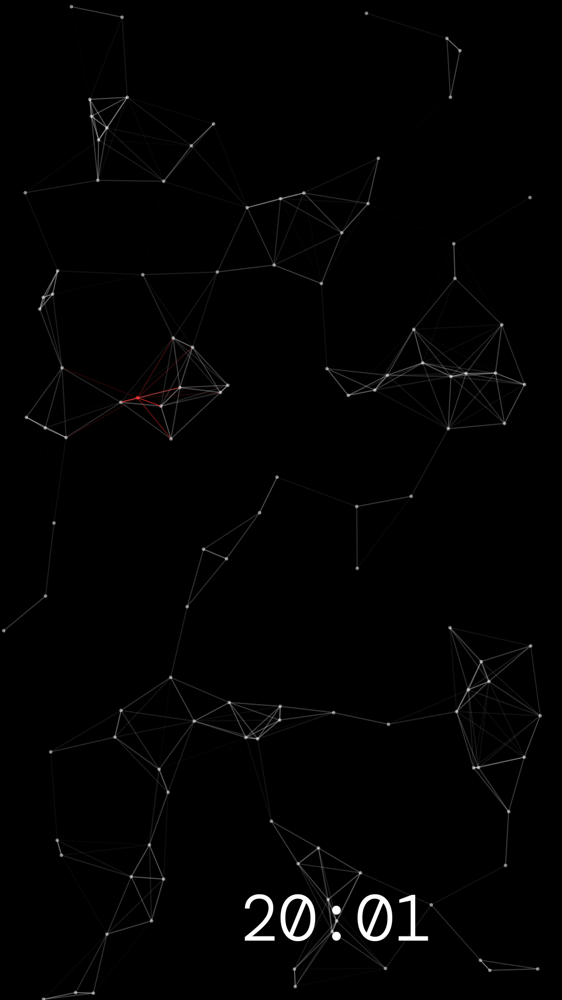

# Particle Clock

A minimal always-on clock for AMOLED screens. A drifting field of connected
particles fills the screen, and the time quietly fades to a new random spot
every so often so nothing burns into the panel.



## Features

- Full-screen particle field with an occasional red accent particle
- Clock fades to a new random position across the whole screen at regular
  intervals, and never gets stuck off-screen on rotation
- Keeps the screen awake, works in any orientation
- Long-press to open settings: clock size, particle count, red particle
  chance and brightness
- Optional Home Assistant control over MQTT: screen brightness, volume and
  custom sounds

## Home Assistant

Long-press → **Home Assistant & sounds…**, enter your MQTT broker (e.g. the
Mosquitto add-on) and tap **Save & connect**. The clock appears automatically
under the MQTT integration as a device with these entities:

| Entity | What it does |
| --- | --- |
| `number` Screen brightness | 0–100 % system screen brightness (switches auto-brightness off) |
| `switch` Auto brightness | the system's adaptive brightness |
| `number` Volume | 0–100 % of the media volume (stays in sync with the volume keys) |
| `button` Play *name* | one per sound; plays it |
| `button` Stop sound | stops whatever is playing |

Changing the system brightness needs the "Modify system settings" permission:
tap **Allow changing system brightness…** on the same screen. Until it's
granted, brightness falls back to dimming only the clock's own window.

Add sounds on the same screen with **Add sound…**. The file is copied into
the app, so you can delete the original afterwards. Each sound gets its own
button entity in Home Assistant right away.

Example actions:

```yaml
- action: number.set_value
  target: { entity_id: number.particle_clock_screen_brightness }
  data: { value: 20 }
- action: button.press
  target: { entity_id: button.particle_clock_play_doorbell }
# Or play any sound by name (handy with templates):
- action: mqtt.publish
  data:
    topic: particleclock/<device id>/sound/play   # shown on the settings screen
    payload: Doorbell
```

Control only works while the clock app is running, which is the normal
state for an always-on clock.

## Build

```
./gradlew assembleDebug
```
